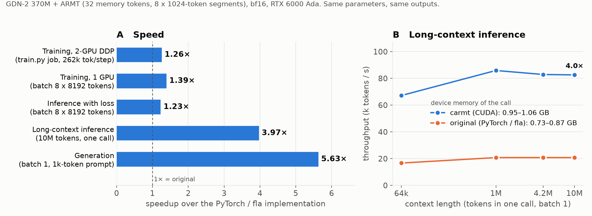

# carmt: a CUDA implementation of recurrent ARMT + GDN-2 — speedup report

*12 Nov 2026; updated after the PyTorch implementation's constant-memory long-context fix. Code: `carmt/` (one CUDA file, `armt.cu`, plus a ctypes binding). Every number below is from a file in
`carmt/records/`. Machine-readable version: `reports/carmt_speedup.json`. Figure: `reports/figures/fig5_carmt_speedup.png`
(regenerate with `python carmt/speedup_figure.py`).*

## Summary

- **What.** `carmt` re-implements the GDN-2 recurrent ARMT (`recurrent_armt.RecurrentARMTForCausalLM` on a GDN-2 backbone)
  as one CUDA/C++ file that depends only on the CUDA runtime and cuBLAS. It runs on the same parameters, gives the same
  outputs, and returns the same carried state. It plugs into training with `carmt.accelerate(model)`, or
  `carmt/train_carmt.py <train.py args>`.
- **Faster.**
  - Training: **1.26×** in the real 2-GPU DDP job, **1.39×** on one GPU.
  - Inference: **1.23×**.
  - Long-context inference: **4.0×** at 10M tokens in one call.
  - Generation: **5.6×**.
- **Long contexts.** Both implementations now process a 10M-token context in one call in about 1 GB:
  - carmt: 82.6k tokens/s;
  - PyTorch: 20.8k tokens/s, after its constant-memory fix for last-position calls.

  carmt also computes a loss over all 10M tokens in one call in 1.4 GB. The PyTorch loss path still keeps every hidden state.
- **Same model.**
  - In a 100-step 2-GPU training run from the same data and seed, the training loss matches the PyTorch run within 2e-4 at
    every logged step (to 4 decimals at 9 of the 10), and the eval losses are identical.
  - In fp32 the logits match an exact (non-TF32) reference to ≤ 1e-4 relative; the original's own TF32 kernels are about
    1e-3 off it.



## Setup

- **Hardware.** `mbz_nlp2`, NVIDIA RTX 6000 Ada (48 GB); 2 GPUs for the DDP numbers, with `NCCL_P2P_DISABLE=1` as in the jobs.
- **Model.** GDN-2 370M (30B-token snapshot) + ARMT: 32 memory tokens, d_mem 64, segments of 1024 tokens, 8 per window; 399.5M
  parameters in total.
- **Precision.** bf16 autocast with fp32 master weights, as in `train.py`.
- **Baseline.** The existing PyTorch implementation with fla 0.6's Triton kernels and gradient checkpointing per (layer, segment),
  as `train.py` runs it. Without checkpointing the original does not fit in 48 GB.

## Results

| workload | original | carmt | speedup |
|---|---|---|---|
| **Training, 2-GPU DDP** (`train.py` job, 262k tokens per optimizer step) | 26.3k tok/s | 33.2k tok/s | **1.26×** |
| Training, 1 GPU (batch 8 × 8192 tokens, forward + backward) | 4.62 s | 3.31 s | **1.39×** |
| Inference with loss (batch 8 × 8192 tokens) | 1.04 s | 0.84 s | **1.23×** |
| Long-context inference, 10M tokens in one call (batch 1, last-position logits) | 20.8k tok/s | 82.6k tok/s | **3.97×** |
| Generation (batch 1, 1k-token prompt + 64 tokens, amortized) | 16.2 ms/token | 2.9 ms/token | **5.63×** |

**Long context** (one call, `output_logits="last"`, no labels, batch 1; device memory used by the call):

| context | carmt | original (fixed) | speedup |
|---|---|---|---|
| 65k tokens | 0.95 GB, 67.2k tok/s | 0.73 GB, 16.7k tok/s | 4.0× |
| 1M tokens | 0.95 GB, 85.9k tok/s | 0.73 GB, 20.8k tok/s | 4.1× |
| 4.2M tokens | 0.98 GB, 82.9k tok/s | 0.79 GB, 20.8k tok/s | 4.0× |
| 10.5M tokens | 1.06 GB, 82.6k tok/s | 0.87 GB, 20.8k tok/s | 4.0× |

- **Memory: both flat.** Since the PyTorch fix (segments-first, one segment embedded at a time, only the last segment's
  hidden states kept), both run in constant memory. carmt uses ~0.2 GB more, mostly its packed bf16 copy of the weights.
- **Speed: ~4×** at every length.
- **With a loss over every token** (labels), the PyTorch `forward` still keeps all hidden states: one call needs 20.7 GB at
  1M tokens and runs out of memory at 4.2M, so such inputs have to be streamed through its `state=` API (3.4 GB at 4.2M
  tokens, 20.3k tok/s). carmt computes the loss per segment and does 10.5M tokens in one call in 1.43 GB at 77.2k tok/s.

**Training memory.**
- One GPU, batch 8: peak 13.5 GB (carmt) vs 14.4 GB (original).
- In the 2-GPU job, `train.py` logs 19.6 GB vs 17.1 GB. carmt's figure includes a flat fp32 gradient buffer.

## Why it is faster

- **One pass over segment + memory tokens.** Per layer and segment, the real tokens and the memory tokens form one
  sequence. Every token-wise operation runs once over it as a few large GEMMs:
  - the 7 input projections of a GDN-2 block are one packed GEMM;
  - `w1 | w2` of the MLP are one packed GEMM.

  The memory tokens continue the recurrent scan, and the state for the next segment is snapshotted after the real tokens.
  This needs no second block call.
- **Chunked GDN-2 scan with custom kernels.**
  - Chunks of 64 tokens with 16-token sub-blocks. The off-diagonal decays are factored through a midpoint so the products
    run on tensor cores without any risk of overflow.
  - The sequential state pass runs on tensor cores (WMMA) with an fp32 state.
  - The chunk-parallel matmuls are batched cuBLAS GEMMs.
- **No framework overhead.** There's no Python per segment and no elementwise PyTorch glue: the original spends at least
  1.07 s of its 4.38 s of GPU time per training step in PyTorch elementwise and copy kernels
  (`carmt/records/profile_rtx6000_original_train.log`). Norms, gates, activations and residuals are fused.
- **Fused loss.** The loss and its gradient are computed in the forward pass, in 4096-row chunks, so `[B, T, vocab]` logits
  are never materialized.
- **Recompute-based backward.** The backward recomputes each (layer, segment) from its stored input, the same memory/compute
  trade-off as gradient checkpointing, but without autograd bookkeeping.
- **Generation without padding.** Generation reuses the fixed-size state; each token costs one segment step without Python
  overhead.

**Where the time goes** (one training step on 1 GPU, 3.48 s of GPU time, `carmt/records/profile_rtx6000_carmt_train.log`):

| part | time | share |
|---|---|---|
| cuBLAS GEMMs (model linears + the scan's chunk-batched GEMMs + memory) | 1.86 s | 53% |
| GDN-2 scan kernels (intra-chunk, state passes, conv/gate prep, gated norm) | 1.30 s | 37% |
| other (norms, activations, loss, memory read/write) | 0.32 s | 9% |

The model's linear layers do 182 TFLOP per step (forward, recomputed forward, backward), so the GEMMs average at least
98 TFLOPS. That figure is a lower bound, since the 1.86 s also includes the scan's GEMMs. For reference, the dense bf16 peak
of the RTX 6000 Ada is 364 TFLOPS.

## Correctness

| check | result |
|---|---|
| fp32 logits, 9 configurations, vs an exact PyTorch reference (fla's own token-by-token GDN-2 recurrence) | ≤ 1e-4 relative; the original's TF32 kernels: ~1e-3 |
| fp32 gradients, every parameter, same 9 configurations | ≤ max(3e-4, 1/5 of the original's own error) |
| real 370M checkpoint, loss in fp32 | 9.5e-7 from the exact reference (original: 1.2e-4) |
| all of the above against the PyTorch code after its long-context fix | 47 / 47 tests pass |
| bf16 gradients at the real dimensions, per parameter vs fp32 | median error 0.84× the original's own bf16 error |
| state continuation, generation == forward, state interchangeable with the PyTorch implementation | ≤ 1e-4 |
| DDP (incl. gradient accumulation and `no_sync`), DeepSpeed ZeRO-1 and ZeRO-2, 2 GPUs | gradients == reference; ranks identical after steps |
| 100-step 2-GPU training run vs the PyTorch run, same data | train loss within 2e-4 at every logged step (equal to 4 decimals at 9 of 10); eval loss identical |

There are 47 GPU tests (`carmt/tests/`), plus `carmt/tests/dist_check.py` for the distributed checks.

## Caveats

- **DDP gains less than one GPU** (1.26× vs 1.39×). The C backward is a single autograd node, so DDP's all-reduce of the
  gradients starts only after it and can't overlap with backward compute.
- **Long-context memory is not an advantage** for last-position inference: since its fix the PyTorch implementation is
  flat too, and uses ~0.2 GB less. carmt's single-call advantage remains only for a loss over every token.
- **Scope.** Only the GDN-2 backbone is supported: short conv size 4, head dim 64 or 128. Other backbones (RWKV-7, Mamba)
  still run on the PyTorch path.
- **DeepSpeed configuration.**
  - Enable `torch_autocast` in DeepSpeed's config; otherwise DeepSpeed silently turns an outer autocast off. Its `bf16` mode
    isn't usable, because it converts the parameters to bf16.
  - Set `lower_precision_safe_modules: []` to keep the gradient all-reduce in fp32.
- **Not done.** FSDP / ZeRO-3 and tensor parallelism are not supported.

## Reproduce

```bash
make -C carmt CUDA_HOME=<cuda toolkit>                     # or: bash carmt/build_env.sh
python -m pytest carmt/tests                              # equivalence (GPU)
torchrun --nproc_per_node 2 carmt/tests/dist_check.py     # DDP / ZeRO-1 / ZeRO-2
python carmt/bench.py                                      # 1-GPU training, inference, generation
python carmt/long_context.py carmt 65536,1048576,4194304,10485760 last   # and: original ...; mode loss
torchrun --nproc_per_node 2 carmt/train_carmt.py <train.py arguments>   # the training job on carmt
python carmt/speedup_figure.py                             # this figure, from reports/carmt_speedup.json
```
