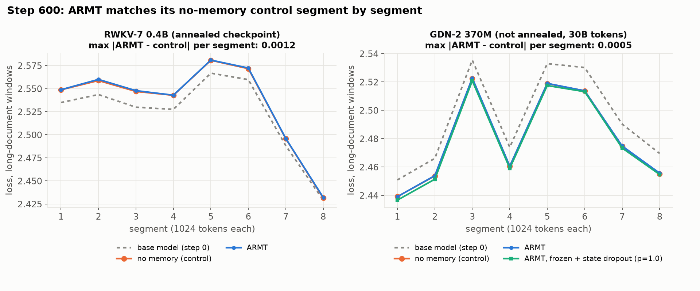
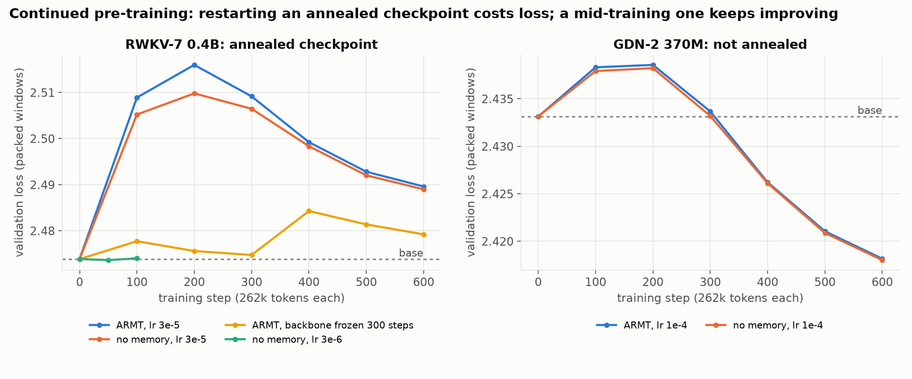
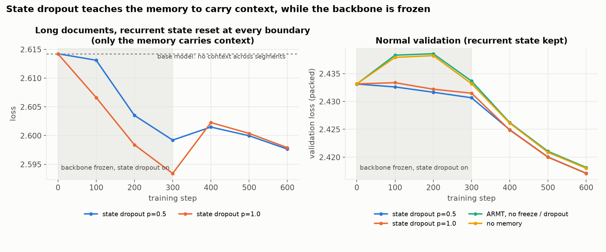
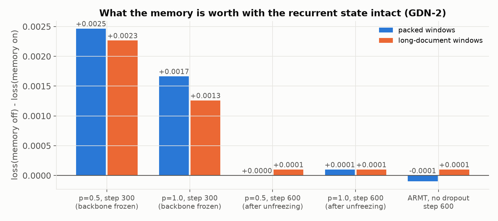

# Recurrent ARMT: associative memory on top of recurrent language models

*Work-in-progress report, 12 Nov 2026. Code: `recurrent_armt/`, runs: `outputs/*/log.jsonl`, figures: `reports/figures/`
(regenerate with `python scripts/report_figures.py`).*

## Summary

- **What.** ARMT (Associative Recurrent Memory Transformer) ported from transformers to recurrent LMs: RWKV-7, GDN-2,
  Gated DeltaNet and other fla models, Mamba, Mamba2. Between segments the model now carries, per layer, the
  associative memory **and** the recurrent state of the block: both fixed-size, both differentiable.
- **Correct.** Layers-first ("horizontal") and segments-first ("vertical") execution are **bitwise identical**. Generation
  token by token on the state matches the forward pass. The state has a constant size, gradients reach earlier segments
  through either path, and all speed-ups are verified exact (204 GPU tests, 5 backbones, 4 real checkpoints).
- **Finding 1: the memory goes unused.** In continued pre-training on FineWeb-Edu (8 segments × 1024 tokens), ARMT matches
  its no-memory control to ≤ 0.0006 nats overall, for RWKV-7 and for GDN-2, also with 256-token segments. Switching the trained
  memory off changes the loss by ≤ 2e-4. The recurrent state already carries the context.
- **Finding 2: a frozen backbone plus recurrent-state dropout makes the memory learn.** With the backbone frozen and the
  recurrent state randomly reset at segment boundaries, the memory recovers 17% of the context lost to a reset (0.021 of
  0.12 nats). It also improves the normal loss by 0.0024 with the state intact.
- **Finding 3: the benefit disappears once the backbone trains without dropout.** After unfreezing, the backbone improves
  on its own and stops reading the memory (memory on vs off: ≤ 1e-4 again).
- **Side finding.** Continued pre-training of an *annealed* checkpoint (RWKV-7 g1a) at lr 3e-5 loses 0.035 nats and does not
  recover in 600 steps; at lr 3e-6 it does not degrade. A *mid-training* checkpoint (GDN-2 at 30B of 100B tokens) improves
  steadily from the start.

---

## 1. Method

**ARMT recap.** The input is split into segments. In every layer, a segment plus `M` memory tokens go through the layer.
The memory tokens' outputs are written into a per-layer associative matrix (DPFP feature map, delta-rule write with the
"new information" correction), and the next segment reads from it. In transformer ARMT this matrix is the *only* path
between segments.

**Recurrent ARMT.** With a recurrent block, the block's state can also cross the boundary, for free. Per layer and segment:

```
h      <- h + read(h, W, z)                     # associative read, segment tokens and memory tokens
h, s   <- block(h, s)                           # the block continues from the recurrent state s of the previous segment
m      <- block(mem_tokens + read(...), s)      # memory tokens: a read-out branch from the state after the segment
W, z   <- write(m, W, z)                        # associative write
state passed on: (W, z, s)                      # fixed size, differentiable
```

- **Memory tokens are a read-out branch** (default). They start from the state after the segment's last token, and their
  own state is discarded. With `W_mv = 0` at initialization (as in the original), recurrent ARMT is then *exactly* the base
  model, so training starts from the pretrained model's quality. `mem_tokens_in_stream=True` instead feeds them into the
  stream.
- **Backbone interface.** One adapter, `block(i, hidden, aux, state) -> (hidden, aux, state)`, continues from any state.
  fla models (RWKV-7, GDN-2, Gated DeltaNet, ...) support this natively. The HF Mamba and Mamba2 blocks can only decode
  one token at a time from a cache, so their mixers are re-implemented on the same weights (CUDA kernels, plus exact
  pure-PyTorch reference scans). Attention models are rejected: their state grows with the sequence.
- **Streaming API.** `forward(..., state)` takes and returns the state, and segment boundaries stay at absolute positions.
  Feeding a sequence in arbitrary pieces therefore equals one forward, and generation is a forward over one token at a time
  (O(1) per token).
- **Constant state.** For example, GDN-2 370M carries ≈ 42 MiB per sequence in fp32 at any context length: per layer, a
  16×128×128 recurrent state, a 384×1024 associative matrix, and three short-conv caches.

## 2. Verification (equivalence and invariance checks)

The tests run on CPU in fp64 and on GPU in fp32; the training ones run in bf16. Throughout, `W_mv` is randomly
initialized: at its zero init the memory writes nothing and its paths would be invisible.

| check | result |
|---|---|
| horizontal (layers-first) == vertical (segments-first): logits & gradients | **bitwise equal**, all 5 backbones and 4 real checkpoints |
| generation (token by token) == forward, across several segment ends | ≤ 6e-6 (fp32 tiny models; Mamba2 7e-5 from TF32 kernels); real checkpoints within the base model's own decode-vs-forward noise, 100% argmax agreement |
| sequence in pieces == one forward (logits and gradients) | ≤ 1e-8 (fp64) |
| state size constant (any length, every generated token) | identical tensors and bytes |
| gradient paths to the first segment | non-zero through the recurrent state alone and through the memory alone; exactly 0 with both cut |
| optimizations: gradient checkpointing, chunked loss, CUDA kernels vs reference scans | exact / ≤ 7e-4 (Mamba2 kernels: TF32) |
| ARMT@init == base model (real checkpoints, independent reference copy) | within kernel noise; ΔCE ≤ 4e-5 |
| associative memory == original ARMT code | ≤ 1e-12, all head/gating/denominator variants |
| state dropout: same in both orders; a reset == fresh start; under resets only the memory path carries gradients | pass |

Real checkpoints: RWKV-7 191M, Mamba 130M, Mamba2 130M, GDN-2 370M. Full log: `results/tests_gpu.txt`.

## 3. Setup

- **Data.** `karpathy/fineweb-edu-100b-shuffle`, streamed: parquet row groups of 1024 documents are read remotely. Row
  groups are shuffled globally and dealt to ranks, so ranks never share a document. Documents are packed into 8192-token
  windows per 16-row-group chunk, and windows sharing a document are kept ≥ 2 optimizer steps apart (never in the same or
  an adjacent batch). The stream is deterministic, so resume is exact. The last shard is held out:
  - `val`: 128 packed windows.
  - `val_long`: 64 windows that each lie entirely inside one document of ≥ 8192 tokens.
  - Median document: 626 tokens; only 12% of tokens are in documents ≥ 8192 tokens.
- **Models.**
  - RWKV-7 0.4B g1a (`fla-hub/rwkv7-0.4B-g1a`): a final, annealed checkpoint.
  - GDN-2 370M (`LLM-OS-Models/gdn2-370m-fineweb-edu-100b`): a 30B-token mid-training snapshot of a 100B-token cosine run,
    converted with `scripts/convert_gdn2.py` (verified: val 2.41 on our windows).
- **Training.**
  - ARMT: 32 memory tokens, d_mem 64, 1024-token segments, 8 segments per window.
  - Optimization: 600 steps × 262k tokens; AdamW with warmup and cosine; bf16; per-(layer, segment) gradient checkpointing;
    2 × RTX 6000 Ada per run.
  - Throughput: RWKV-7 14.6k (ARMT) / 16.7k (control) tokens/s; GDN-2 26.0k / 27.8k.

## 4. Results

### 4.1 ARMT does not beat its no-memory control



| run (step 600) | val | val_long |
|---|---|---|
| RWKV-7 base (step 0) | 2.4738 | 2.5224 |
| RWKV-7 + ARMT | 2.4896 | 2.5351 |
| RWKV-7, no memory | 2.4890 | 2.5346 |
| GDN-2 base (step 0) | 2.4331 | 2.4936 |
| GDN-2 + ARMT | 2.4182 | 2.4799 |
| GDN-2 + ARMT, 256-token segments | 2.4181 | 2.4799 |
| GDN-2, no memory | 2.4180 | 2.4798 |

The memory *is* trained (`W_mv` grows from 0 to rms ≈ 3e-3 in every layer), but zeroing it in the final GDN-2 model
changes the loss by ≤ 2e-4 in every segment. The training curves of ARMT and its control coincide step by step.

### 4.2 Annealed vs mid-training checkpoints



- **RWKV-7 (annealed).** Restarting at lr 3e-5 costs ≈ 0.035 nats; after 600 steps the loss is still 0.016 above base.
  - At lr 3e-6 there is no degradation (2.4740 at step 100), which confirms a re-warm effect rather than a pipeline bug.
  - Freezing the backbone for the first 300 steps (memory training only) keeps the model near base (2.4747 at step 300).
    The degradation starts when the backbone trains.
- **GDN-2 (mid-training, not annealed).** A small bump (+0.005), then it improves past base: −0.015 at step 600.

### 4.3 State dropout during a frozen-backbone phase trains the memory



Setup: GDN-2 with the backbone frozen for 300 steps. In that phase, each sample's recurrent state is reset at each segment
boundary with probability p (the memory state is kept). For steps 300–600 the backbone trains, without dropout.

`val_long_reset` is long documents with the state reset at *every* boundary, so only the memory carries context. The base
model loses 0.12 nats there (2.4936 → 2.6142).

| | val | val_long | val_long_reset | context recovered |
|---|---|---|---|---|
| base | 2.4331 | 2.4936 | 2.6142 | – |
| p = 0.5, step 300 (frozen) | 2.4307 | 2.4914 | 2.5992 | 0.015 (12%) |
| p = 1.0, step 300 (frozen) | 2.4315 | 2.4924 | 2.5934 | 0.021 (17%) |
| p = 0.5, step 600 | 2.4171 | 2.4783 | 2.5976 | 0.017 |
| p = 1.0, step 600 | 2.4171 | 2.4783 | 2.5979 | 0.016 |

### 4.4 …but the backbone stops using it once it trains



Memory value = loss(memory off) − loss(memory on), recurrent state intact.

- **Step 300.** The backbone is still the base model, so "memory off" is the base model exactly.
- **Step 600.** Measured by zeroing `W_mv` in the final models.

After unfreezing, the memory still carries some context when the state is cut (`val_long_reset` 2.598 vs 2.614). But
with its own state available, the trained backbone ignores it.

## 5. Interpretation

- **The recurrent state covers what the memory could add.** In transformer ARMT the memory is the only path between
  segments; here the backbone has its own. GDN-2's per-segment loss on long documents stays flat across 8 segments
  (8 × 1024 tokens, 2× its 4k training context), so within these windows it is not forgetting much.
- **The data gives little to gain.** Most packed windows are several short unrelated documents.
- **Joint training removes the incentive.** Once both can train, improving the backbone is the easier path, and the memory
  pathway decays to no-op.

## 6. Next steps

1. **Keep a reason to read the memory during joint training.** Keep state dropout on after unfreezing (p ≈ 0.1–0.25).
   Measure with the memory on/off ablation and `val_long_reset`.
2. **Contexts beyond what the state retains.** For example 32 × 1024 tokens (8× GDN-2's training context), and / or
   long-document-only training (`--min_doc_tokens 8192`).
3. **Retrieval tasks** (BABILong / associative recall), where a fixed-size recurrent state saturates and ARMT has shown
   gains before.
4. **Longer training** (the Gemma ARMT trained 38k steps; these pilots are 600).

## 7. Reproduce

```bash
python /path/to/router/route.py run jobs/tests.json          # all checks on a GPU
python /path/to/router/route.py run jobs/train.json          # RWKV-7 and GDN-2 pairs (ARMT / no memory)
python /path/to/router/route.py run jobs/seg256.json         # 256-token segments
python /path/to/router/route.py run jobs/state_dropout.json  # frozen backbone + state dropout, p = 0.5 / 1.0
python scripts/report_figures.py                             # these figures, from outputs/*/log.jsonl
```

Key options in `train.py`:

| option | what it does |
|---|---|
| `--num_mem_tokens 0` | no memory: the control |
| `--segment_size` / `--n_segments` | segment length and number of segments per window |
| `--freeze_backbone_steps N` | train only the memory for N steps |
| `--rnn_state_dropout p` / `--rnn_state_dropout_steps N` | reset the recurrent state at boundaries with probability p, for N steps |
| `--eval_state_reset` | also evaluate `val_long_reset` |
| `--wandb_project` | log to wandb |
